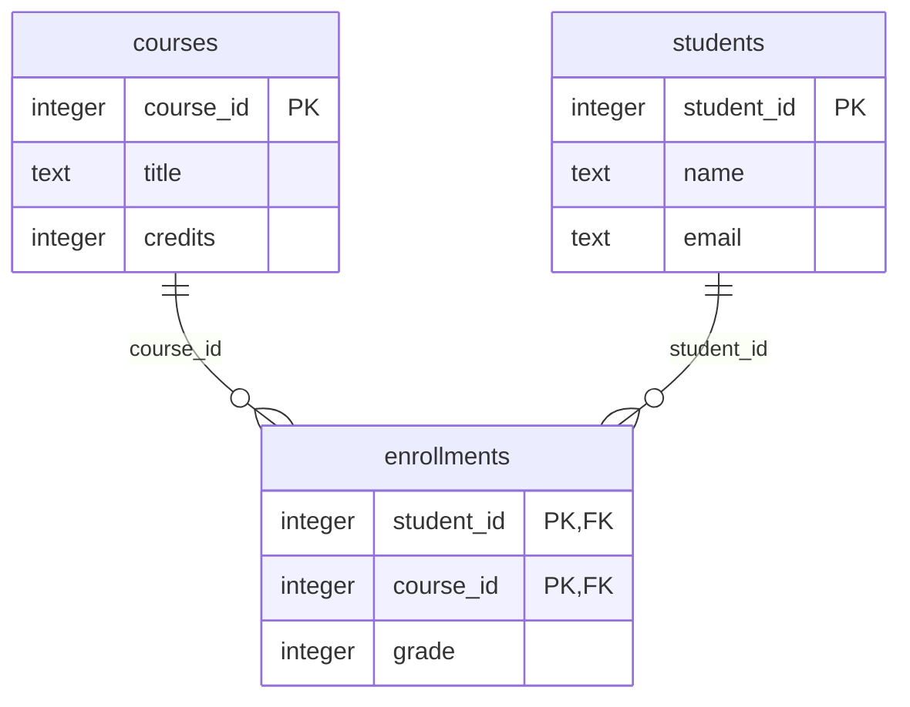

## TL;DR

- 先執行 DDL，再讀取資料庫真正建立的表、欄位與外鍵，避免手繪 ERD 與 schema 脫節。
- 此教學腳本針對已知的三表模型，將外鍵畫成父表一對子表零到多；不是適用所有 schema 的完整關聯推導器。
- 可選外鍵、唯一外鍵、組合外鍵與識別字轉義需要額外分析；MySQL 改查 information_schema。

## 1. 概念與前置知識

本單元整理「由資料庫中繼資料自動產生 ERD」。前置單元：Q07。先掌握範例中的資料如何流動，再處理邊界與錯誤情況。

## 2. 語法速查

| 寫法 | 用途 |
|---|---|
| `PRAGMA table_info(table)` | 讀取欄位與主鍵 metadata |
| `PRAGMA foreign_key_list(table)` | 讀取宣告的外鍵關係 |

## 3. 最小範例與驗證

環境：Python 3.12.12。

撰寫環境：VS Code。上方版本資訊是本次範例驗證使用的環境，不代表當年學習時的版本。

除 Q08 外，先載入[共同測試資料 fixtures.sql](/QTpsTlZmcVVHSUxEOkpRRw/assets/learning/sql/fixtures.sql)。資料全部為合成範例，每次測試從新的記憶體資料庫開始。SQL 語句以 SQLite 驗證；⚠️ 未在 MySQL 執行，方言專屬行為不可直接外推。


```python
import sqlite3
from pathlib import Path

connection = sqlite3.connect(":memory:")
connection.executescript(Path("fixtures.sql").read_text(encoding="utf-8"))
tables = [row[0] for row in connection.execute(
    "SELECT name FROM sqlite_master WHERE type='table' AND name NOT LIKE 'sqlite_%' ORDER BY name"
)]
print("erDiagram")
for table in tables:
    quoted = '"' + table.replace('"', '""') + '"'
    foreign_keys = connection.execute(f"PRAGMA foreign_key_list({quoted})").fetchall()
    fk_columns = {row[3] for row in foreign_keys}
    for row in foreign_keys:
        print(f'    {row[2]} ||--o{{ {table} : "{row[3]}"')
    print(f"    {table} {{")
    for _, name, kind, required, default, primary in connection.execute(f"PRAGMA table_info({quoted})"):
        keys = []
        if primary:
            keys.append("PK")
        if name in fk_columns:
            keys.append("FK")
        print(f"        {kind.lower() or 'text'} {name} {','.join(keys)}".rstrip())
    print("    }")
connection.close()
```

輸入：無；範例使用內建或共同測試資料。

實際輸出：

```text
erDiagram
    courses {
        integer course_id PK
        text title
        integer credits
    }
    courses ||--o{ enrollments : "course_id"
    students ||--o{ enrollments : "student_id"
    enrollments {
        integer student_id PK,FK
        integer course_id PK,FK
        integer grade
    }
    students {
        integer student_id PK
        text name
        text email
    }
```

## 4. 常見陷阱

以下為語法與行為對照；⚠️ 錯誤片段未逐一獨立執行，涉及未定義行為的案例也不以某次輸出當成保證。

### 陷阱 1

錯誤：只依欄位名稱猜外鍵 → 可能畫出資料庫根本沒定義的關係。修正：讀取外鍵 metadata。

### 陷阱 2

錯誤：把每個外鍵都當成完全相同的基數 → UNIQUE 與 NULL 規則可能不同。修正：將產生器限定在已驗證模型，擴充時再解析額外約束。

## 5. 執行與判題格式

查詢練習只提交題目要求的 SQL；題目已提供 schema 時，不要額外提交 CREATE TABLE。Q06–Q08 則在本機建立測試資料庫，確認約束與 ERD。

## 6. 練習

以下三題是針對本單元撰寫的自訂實作，沒有附完整解答，也不宣稱已通過任何線上判題。

1. 自行設計三表、多對多主題，執行 DDL、擷取 metadata、產生 Mermaid，最後實際渲染並檢查圖形與資料庫一致。
2. 調整本篇範例的資料，至少涵蓋一般值、邊界值與無效值三種情境；執行前先預測結果，再記錄真實差異。
3. 從兩個常見陷阱各設計一個最小反例，說明原因並修正；涉及未定義行為時，以規格與編譯診斷說明，不故意執行危險操作。

延伸題庫：[LeetCode SQL 50](https://leetcode.com/studyplan/top-sql-50/)。題號、難度與已解狀態需在選題時另行確認；SQL 僅選前四個主題區，C++ 題目介面避免 STL 容器。

## 7. 自我檢測

這個最小腳本能精準推導任何資料庫的所有基數嗎？

<details><summary>答案</summary>

不能；它只對本文固定的必填外鍵、多對多連結表模型成立。

</details>

## 8. 來源與課綱對照

- [Official tutorial](https://mermaid.js.org/syntax/entityRelationshipDiagram.html)：語言或框架參考文件。

## 9. 實際產生的 ERD

產生器已執行，並使用本站的 Mermaid 相容渲染器產生 SVG。此流程未使用 Mermaid CLI，因此不宣稱已執行 mmdc。

[Download SVG](/QTpsTlZmcVVHSUxEOkpRRw/assets/learning/sql/schema.svg) · [Mermaid source](/QTpsTlZmcVVHSUxEOkpRRw/assets/learning/sql/schema.mmd) · [Python script](/QTpsTlZmcVVHSUxEOkpRRw/assets/learning/sql/ddl2mermaid.py)


